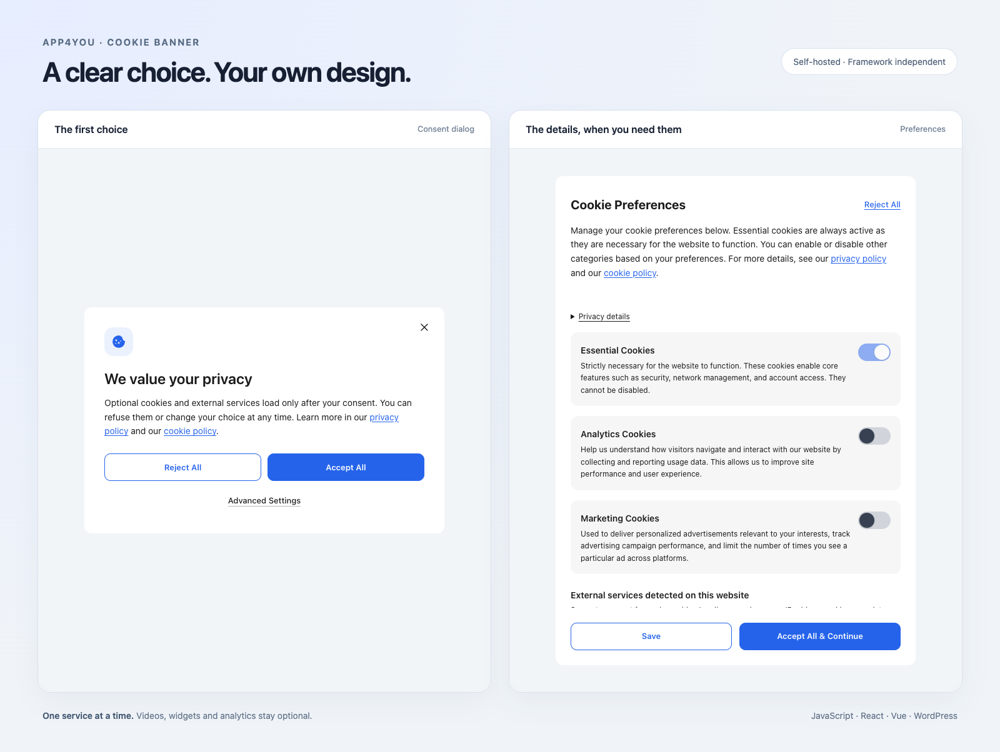

<div align="center">

# Cookie Banner

**Cookie consent that fits your website.**

A self-hosted banner with per-service choices, blocked-content placeholders,<br />
Google Consent Mode v2 and a WordPress plugin. Use it with your existing framework.

[](https://www.npmjs.com/package/@app4you/cookie-banner)
[](#api)
[](#what-you-get)

[Live demo](https://dawidw5219.github.io/cookie-banner/) · [Quick start](#quick-start) · [Advanced](#advanced) · [WordPress](#wordpress) · [Documentation](#documentation)

</div>



<p align="center"><sub>The actual consent dialog and preferences panel. Colors, text and layout are configurable.</sub></p>

## What you get

| | |
|---|---|
| **Choices per service** | Let visitors enable an individual video, widget or provider. |
| **Content that waits** | Keep optional embeds and scripts inactive until consent. Show a local placeholder instead of contacting a provider for a thumbnail. |
| **Two layouts** | A consent dialog or a bottom bar, with a preferences panel and a way to withdraw consent. |
| **Your framework** | A bundled Preact interface behind a framework-independent API. Your app does not need React or Preact. |
| **Google Consent Mode v2** | Send category choices to Google Tag Manager in GTM mode. |
| **10 languages** | English, Polish, German, French, Spanish, Italian, Dutch, Danish, Norwegian and Swedish. |

## Quick start

```bash
npm install @app4you/cookie-banner
```

Initialize once in the browser:

```ts
import { initializeConsent } from '@app4you/cookie-banner';

const dispose = await initializeConsent({
  mode: 'standalone',
  lang: 'en',
  controller: { name: 'Your Company' },
  noticeVersion: '1',
  purposes: 'Play optional videos on this website.',
  privacyPolicyUrl: '/privacy',
});
```

Use your actual company, purpose and privacy policy. Call `dispose()` when the integration unmounts. The import is safe during server rendering; initialize after hydration.

The banner is ready. To enable optional providers, add their disclosures and inactive embeds as shown below.

## Advanced

<details>
<summary><strong>Providers, embeds, SDKs and appearance</strong></summary>

### Configure providers

```ts
import { initializeConsent } from '@app4you/cookie-banner';

const dispose = await initializeConsent({
  mode: 'standalone',
  lang: 'en',
  variant: 'modal', // or 'bar'
  noticeVersion: 'privacy-1',
  controller: { name: 'Your Company' },
  purposes: 'Play optional videos embedded on this website.',
  privacyPolicyUrl: '/privacy',
  services: [{
    id: 'youtube',
    name: 'YouTube',
    description: 'Play videos embedded on this website.',
    privacyUrl: 'https://policies.google.com/privacy',
    retention: 'Describe the retention used by your integration.',
  }],
});

// Call dispose() when the application integration is unmounted.
```

Replace the sample controller, purpose, retention and policy with your site's actual information. Incomplete provider information keeps that provider disabled.

In React or Next.js, initialize in a client effect. In Vue, use `onMounted()`. In both cases, release the returned cleanup function when the owner is unmounted. See the [integration guide](docs/consent-integration.md) for an async-safe React example.

### Keep optional content inactive

Use `data-cb-src` in place of a live `src`. The banner creates a placeholder and activates the embed after the visitor chooses that service.

```html
<iframe
  data-cb-service="youtube"
  data-cb-src="https://www.youtube-nocookie.com/embed/VIDEO_ID"
  title="Product video"
  hidden
></iframe>
```

For React or Preact, the same attributes are available as props:

```tsx
import { blockedContentProps } from '@app4you/cookie-banner';

<iframe
  {...blockedContentProps('youtube', 'https://www.youtube-nocookie.com/embed/VIDEO_ID')}
  title="Product video"
/>;
```

For an SDK that starts when mounted, subscribe **before loading the SDK**:

```ts
import { onServiceConsent } from '@app4you/cookie-banner';

const unsubscribe = onServiceConsent('support-chat', (granted) => {
  if (granted) mountChat();
  else unmountChat();
});
```

Register `support-chat` in `services` with its purpose, policy and retention. Call `unsubscribe()` when the integration is unmounted.

### Make it yours

Set these fields in the configuration passed to `initializeConsent()`:

```ts
variant: 'bar',
buttonStyle: 'standard', // 'equal' gives both decision buttons the same appearance
lang: 'en',
theme: {
  primary: '#2563eb',
  background: '#ffffff',
  text: '#1a1a1a',
},
```

Use `customTexts` for copy changes and `localizations` for route-specific languages, purposes and provider disclosures. [Language configuration →](docs/multilingual.md)

</details>

## Development scanner

Inspect the current page while testing your app, without mounting a banner:

```ts
if (import.meta.env.DEV) {
  const { startCookieScan } = await import('@app4you/cookie-banner/dev');
  const stop = startCookieScan(report => console.log(report));
  // Call stop() when the integration unmounts.
}
```

Reports accessible **cookie names, storage keys and resource origins**. No stored values, no URL parameters, no uploads. The scanner is a separate entry; import it only in development. Use `scanCookies()` for a one-off snapshot.

Current page only: HttpOnly cookies, third-party iframe storage and server-side tracking are outside its view. Polling can miss short-lived changes; resource origins describe requests already observed in this document, not a complete network audit. [Scanner details](docs/consent-integration.md#skanowanie-podczas-testowania-aplikacji).

## WordPress

[Download the latest plugin ZIP](https://github.com/Dawidw5219/cookie-banner/releases/latest), upload it under **Plugins → Add New → Upload Plugin**, and activate it.

The plugin adds:

- An administration panel for appearance, copy and provider information.
- Cookie/storage scanning and service detection while an administrator browses the site.
- PHP content blocking, consent-dependent CSP and cache integrations.
- Local consent-receipt storage, WPML/Polylang integration and GitHub-release updates.

The npm package contains the browser consent engine. It does **not** include the WordPress administration panel, database or a site-wide cookie crawler. `getDetectedServices()` reports configured and observed services on the current page.

## How blocking works

**Start with inactive HTML.** A banner cannot undo requests that an existing script or live iframe has already made. Use the inert attributes above and integrate SDK loading with service consent.

For server-enforced network restrictions, enable `strictCsp` and send the headers returned by `consentCspHeaders()` from your application server. The WordPress plugin enables strict CSP by default. `autoBlock` adds a compatibility guard for common dynamic loaders.

Service choices and analytics/marketing category choices are separate. Withdrawing consent reloads the page, because removing a script element cannot undo an SDK's timers and listeners.

[Full integration and blocking guide →](docs/consent-integration.md)

## API

Import from `@app4you/cookie-banner`:

| Function | Purpose |
|---|---|
| `initializeConsent(config)` | Mount the banner; returns a cleanup function asynchronously. |
| `blockedContentProps(id, src)` | Generate inactive attributes for an embed. |
| `blockedScriptProps(id, src)` | Generate inactive attributes for a script. |
| `hasServiceConsent(id)` | Read the current choice for a service. |
| `onServiceConsent(id, callback)` | Subscribe to a service choice; returns an unsubscribe function. |
| `setServiceConsent(id, granted)` | Update a service choice. |
| `getDetectedServices()` | Read configured and observed services. |
| `getConsentReceipt()` | Read the current local consent receipt. |
| `consentCspHeaders(options, cookieHeader)` | Build consent-dependent HTTP CSP and cache headers. |

The package root is the framework-independent, SSR-safe API. `/native` remains a compatibility alias. `/auto` is the browser-only, auto-starting bundle. **Migration:** if you previously imported the package root just to start the banner, change that side-effect import to `@app4you/cookie-banner/auto`.

## Documentation

| Guide | Covers |
|---|---|
| [Integration](docs/consent-integration.md) | npm, Next.js, SDKs, WordPress, blocking and CSP. |
| [Consent configuration](docs/consent-compliance.md) | Required information, receipts and withdrawal. |
| [Languages](docs/multilingual.md) | Translations, regional overrides, WPML and Polylang. |
| [Deployment](docs/deployment-security.md) | SSH/SVN deployment and receipt-storage limits. |

<details>
<summary><strong>Development and releases</strong></summary>

```bash
bun install
bun run dev          # Open the development demo
bun run test         # Unit and regression tests
bun run build        # npm bundle, types, WordPress admin and plugin ZIP
bun run build:demo   # Static live demo for GitHub Pages
bun run test:demo    # Production demo, scanner and consent-gated video
```

Builds start with type checking. Missing translation keys, incorrect translation types or invalid editor keys stop the build.

```bash
bun run test:package        # Check the packed npm package and its SSR/types entry
bun run test:privacy        # Browser consent and network-blocking scenarios
bun run test:accessibility  # Browser accessibility checks
```

`test:package`, `test:privacy` and `test:accessibility` use the generated build. Test evidence is written to the system temporary directory.

```bash
bun run deploy --dry-run    # Review the deployment plan
bun run deploy             # Build → tests → GitHub Release + ZIP → npm
```

Deployment requires authenticated `gh` and `npm`, plus `ghdeploy`. Set the same version in `package.json`, the plugin header, `COOKIE4_VERSION` and the plugin readme's `Stable tag`. Use a new version if the previous one is already published or staged in npm. npm may require 2FA or staged approval.

The article in `example/` uses a real YouTube embed, blocked until the visitor allows YouTube. It opens with a dialog and equal decision buttons. A small settings menu switches the presentation; the opt-in scanner supports synthetic test data. Tests mock the video provider and verify that refusal sends no provider requests.

The `Live demo` GitHub Actions workflow builds the demo on pushes to `main` and deploys `example/dist` to GitHub Pages. Select **GitHub Actions** as the Pages publishing source in the repository settings.

Sources: `src/core` for consent logic, `src/ui` for atomic controls, `src/components` for composed views, `src/hooks` for hooks, and `plugin/src` for the WordPress admin. Tests live in `tests` and `plugin/tests`.

</details>

---

Built by [App4You](https://app4you.dev). Third-party database attribution: [NOTICE](https://github.com/Dawidw5219/cookie-banner/blob/main/plugin/NOTICE).
